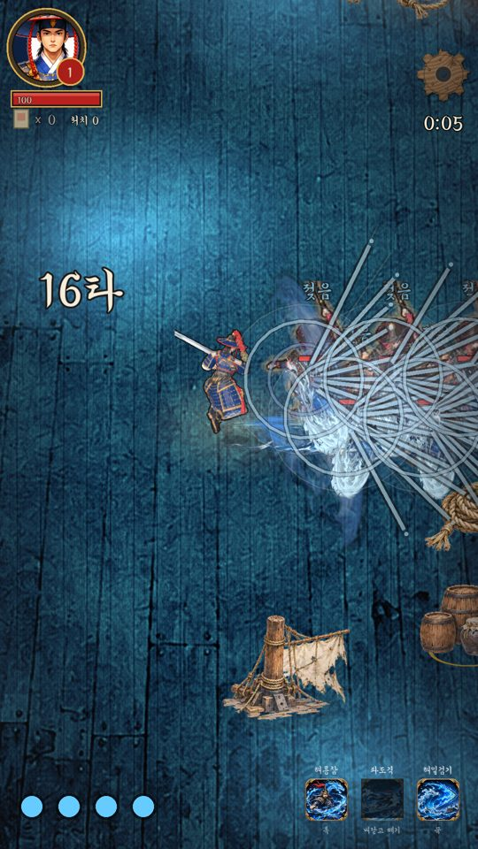
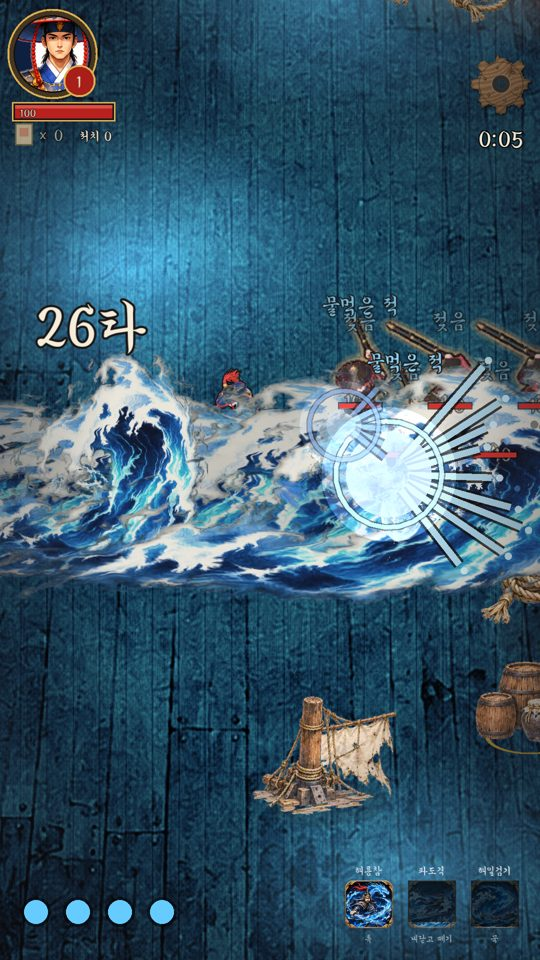

# 강화 패 짝 (맞물림) 제안서

상태: **제안 + 순신 견본 하나** (2026-11-24). 사용자 결정: 넣되 우선순위는 뒤. 견본 말고는 승인 뒤 구현.

짝: 두 패를 모두 가지면 추가 효과가 켜진다. 수치를 더 올리지 않는다. 기술끼리 서로 맞물리게 한다.
화면 글은 "짝"으로 쓴다. 외래어는 쓰지 않는다.

## 1. 지금 패 목록

일반 패는 `data/upgrades/<영웅>.tres`, 큰 변형은 `<영웅>_major.tres`에 있다. 괄호 안은 id, 숫자는 최대 횟수다.

| 영웅 | 누르기(tap) | 내닫기(dash) | 모으기(charge) | 반격(counter) | 공통 |
|---|---|---|---|---|---|
| 순신 | 해룡참 넓은 물결(haeryong_wide)3 · 깊은 베기(haeryong_deep)3 · 빠른 손(haeryong_quick)3 | 파도격 연파(pado_more)3 · 긴 물길(pado_long)2 | 해일검기 큰 해일(haeil_big)3 · 빠른 충전(haeil_fast)2 | 노도(counter_power)3 · 기회(counter_window)2 | 고른 숨 · 강건 · 날 세우기 · 발놀림 |
| 큰 변형 | 소용돌이 | 물보라 | 세 갈래 | 사방 검기 | |
| 광개토 | 뇌진격 넓은 진동(quake_wide) · 무거운 검(quake_heavy) · 혼절(quake_daze) · 연타(quake_quick) | 벽력돌파 굉음(trail_power) · 넓은 벼락(trail_wide) | 낙뢰 많은 벼락(bolt_more) · 강한 벼락(bolt_power) · 빠른 충전(bolt_fast) | 정복자의 일격 위엄(conq_power) · 기회(conq_window) | 숨 고르기 · 강건 · 날 세우기 |
| 큰 변형 | 여진 | 감전 지대 | 연쇄 | 천둥 군림 | |
| 세종 | 정음진 굳센 획(jeong_dmg) · 넓은 고리(jeong_wide) · 긴 울림(jeong_long) · 빠른 붓(jeong_quick) | 유성 무거운 별(meteor_dmg) · 큰 별(meteor_wide) | 성좌진 많은 별(star_more) · 밝은 별(star_dmg) · 빠른 관측(star_fast) | 해시계 긴 그림자(sundial_long) · 정오(sundial_dmg) | 강건 · 또렷한 글자 · 걸음 |
| 큰 변형 | 두 겹 고리 | 유성우 | 북두칠성 | 멈춘 시간 | |
| 사임당 | 풀벌레 한 마리 더(critter_more) · 날카로운 턱(critter_dmg) · 긴 숨(critter_long) · 빠른 붓(critter_quick) | 발묵 깊은 먹(ink_long) · 진한 먹(ink_heavy) · 스미는 먹(ink_dmg) | 화폭 넓은 화폭(canvas_wide) · 오래 가둠(canvas_hold) · 짙은 채색(canvas_dmg) | 매화 향기(plum_heal) · 만개(plum_dmg) | 강건 · 날 세우기 |
| 큰 변형 | 화접도 | 먹구름 | 병풍 | 꽃비 | |

일반 패는 영웅마다 13~14장이다. 짝은 모두 일반 패끼리 묶었다. 큰 변형은 한 판에 하나씩만 나와 짝으로 묶으면 맞추기 너무 어렵다.

## 2. 영웅별 짝 (3짝씩)

"재사용"은 이미 있는 상태나 판정을 그대로 쓴다는 뜻이다. "새로"는 새로 만들어야 하는 부분이다.

### 순신 — 물결

| 짝 | 패 A + 패 B | 효과 | 구현 | 균형 위험 |
|---|---|---|---|---|
| **젖은 바다** (견본, 구현됨) | 파도격·연파 + 해일검기·큰 해일 | 파도격에 맞은 적은 4초간 젖는다. 젖은 적은 해일검기 피해가 1.5배다. | 표식 틀 `SynergyMark`를 새로 만들었다. 피해는 `SkillContext.hit`과 탄 명중을 지나므로 기술 파일은 건드리지 않았다. | 중간. 내닫기 → 모으기 순서를 배우면 우두머리에게 크게 들어간다. 배율 데이터는 1.3~1.5 안에서 시뮬로 정한다. |
| 소용돌이 물길 | 해룡참·넓은 물결 + 파도격·긴 물길 | 해룡참으로 벤 자리를 파도격이 지나가면 물길 끝에 작은 소용돌이가 1초 생겨 적을 끌어당긴다. | 큰 변형 "소용돌이"(`whirl_time`)의 작은 판을 재사용한다. 벤 자리 기억은 새로 만든다(표식 틀에 자리 표식 추가). | 큰 변형 소용돌이와 겹치면 묶는 시간이 길어진다. 겹칠 때는 효과를 하나만 켠다. |
| 노도의 반격 | 반격·기회 + 해룡참·빠른 손 | 반격에 성공하면 3초 동안 해룡참 재사용 대기가 절반이다. | 반격 성공 신호가 있다. 재사용 대기 배율은 새로 만든다(기술 사용 쪽에 잠깐 배율). | 높다. 연타 마무리까지 빨라진다. 3초는 데이터로 두고 2~3초에서 시뮬로 정한다. |

### 광개토 — 천둥

| 짝 | 패 A + 패 B | 효과 | 구현 | 균형 위험 |
|---|---|---|---|---|
| 감전 | 벽력돌파·넓은 벼락 + 낙뢰·많은 벼락 | 벽력돌파에 맞은 적은 4초간 감전된다. 낙뢰는 감전된 적을 먼저 노리고 피해가 1.5배다. | `SynergyMark`를 그대로 쓴다(데이터만). "먼저 노림"은 낙뢰 대상 고르기에 표식 우선을 새로 넣는다. | 중간. 순신 짝과 같은 틀이라 수치를 맞춰 둔다. |
| 땅울림 | 뇌진격·혼절 + 정복자의 일격·위엄 | 기절한 적이 정복자의 일격에 맞으면 그 자리에 여진이 한 번 더 친다. | 기절 상태와 큰 변형 "여진"(`aftershock_delay`) 치기를 재사용한다. | 낮다. 반격은 원래 드물다. |
| 질풍 돌격 | 돌격·숨 고르기 + 벽력돌파·굉음 | 벽력돌파 한 번에 적 셋 이상을 맞히면 돌격 한 칸을 바로 돌려받는다. | 맞힌 수는 `SkillRun.hits`를 재사용한다. 돌격 돌려받기는 새로 만든다. | 높다. 무리 속에서 끝없이 내닫을 수 있다. 3초에 한 번까지로 막는다. |

### 세종 — 글자와 별

| 짝 | 패 A + 패 B | 효과 | 구현 | 균형 위험 |
|---|---|---|---|---|
| 별 아래 유성 | 유성·큰 별 + 성좌진·밝은 별 | 성좌진 안에 떨어진 유성은 한 발 더 떨어진다. | 큰 변형 "유성우"(`extra_stars`)의 별 하나 떨구기를 재사용한다. 자리가 성좌진 안인지 보는 판정은 새로 만든다. | 중간. 유성우와 겹치면 별이 많아진다. 화면 혼잡을 사진으로 확인한다. |
| 별빛 글자 | 성좌진·많은 별 + 정음진·넓은 고리 | 성좌진과 겹친 정음진 글자는 피해가 1.5배다. | 겹침 판정(같은 영역 판정)은 새로 만든다. 피해 배율은 `SynergyEffect.adjust`를 그대로 쓴다. | 낮다. 두 기술을 같은 자리에 둬야 한다. |
| 정오의 그림자 | 해시계·긴 그림자 + 정음진·긴 울림 | 느려진 적이 정음진 글자에 맞을 때마다 느려짐이 0.3초 늘어난다(최대 3초). | 느려짐 상태를 재사용한다. 늘리기는 표식 틀에 "연장" 선택을 더한다. | 중간. 우두머리를 오래 묶을 수 있다. 우두머리에게는 절반만 건다. |

### 사임당 — 먹과 그림

| 짝 | 패 A + 패 B | 효과 | 구현 | 균형 위험 |
|---|---|---|---|---|
| 먹 먹은 풀벌레 | 발묵·스미는 먹 + 풀벌레·날카로운 턱 | 발묵 번짐에 닿은 적은 먹이 묻는다(3초). 먹 묻은 적은 풀벌레 피해가 1.5배다. | `SynergyMark`를 그대로 쓴다(데이터만). 번짐은 계속 닿으므로 표식만 새로 고친다. | 중간. 소환 수가 늘면 곱으로 커진다. 시뮬로 본다. |
| 그림 속 먹 | 화폭·오래 가둠 + 발묵·진한 먹 | 화폭에 가둔 적 둘레에 작은 발묵이 저절로 번진다. | 발묵 장판 만들기를 재사용한다(작게, 피해 0, 느려짐만). | 낮다. |
| 매화 나비 | 매화·향기 + 풀벌레·긴 숨 | 반격에 성공하면 풀벌레 하나가 매화 나비로 다시 날아 2초 더 싸운다. | 큰 변형 "화접도"(`extra_butterflies`)의 나비 하나를 재사용한다. | 낮다. |

## 3. 패 고르기 화면 표시안

- **짝이 되는 패:** 이미 가진 패와 짝이 되는 패가 나오면, 패 테두리를 **금실** 한 줄로 두르고 아래에 "짝: 파도격 · 연파"를 작게 적는다.
- **짝이 맞았을 때:**
  - 고르는 순간 두 패 인장이 한 번 부딪쳐 빛난다.
  - 숨 고르기가 끝날 때 위쪽 띠에 "짝이 맞았다 · 젖은 바다"를 1.2초 띄운다. 영웅 대사 줄과 같은 붓글씨를 쓴다.
- **멈춤 화면의 가진 패 목록:** 맞은 짝은 두 패를 금실로 잇고, 효과 설명 한 줄을 붙인다.
- **뽑기 보정 (선택):** 짝의 한쪽을 가지면 다른 쪽이 나올 가중치를 1.5배로 한다. 데이터는 `SynergyDef.partner_weight`로 둔다.
  - 보정이 없으면 영웅당 13장 중 정해진 두 장을 모아야 해서, 짧은 판에서는 거의 안 맞는다.

견본에는 화면 표시가 없다. 싸움 중 표시만 있다: 적 위에 "젖음", 더 세게 들어갈 때 "물먹은 적", 고리.

## 4. 데이터 구조 (견본에 들어간 것)

- `UpgradePool.synergies: Array[SynergyDef]`: 영웅마다 자기 짝 목록을 둔다.
- `SynergyDef` (`scripts/run/synergy_def.gd`): 필드는 `id`, `title`, `description`, `needs`(UpgradeDef id 목록), `effect`.
- `SynergyEffect` (`scripts/run/synergy_effect.gd`): 효과의 공통 틀이다.
  - `adjust(ctx, 적, 피해)`: 기술 명중 직전에 피해를 바꾼다.
  - `on_projectile_hit(ctx, 탄, 적)`: 기술 탄의 첫 타를 맞춘다.
- `SynergyMark` (`scripts/run/synergy_mark.gd`): 표식 틀이다. 순신·광개토·사임당 짝 하나씩이 데이터만으로 이것을 쓴다.
  - 필드: `mark_skill`, `mark_tag`, `mark_time`, `bonus_skill`, `bonus_mult`, 띄울 글, 색.
- `SynergyState` (`scripts/run/synergy_state.gd`): 이번 판에 켜진 짝이다.
  - `RunBuild`가 패를 적용할 때마다 다시 세고, 판이 시작되면 비운다.
- 연결 지점은 두 곳뿐이다: `SkillContext.hit`(피해 직전)과 `SkillContext.on_projectile_hit`. 영웅·기술 파일은 짝을 모른다.
- 데이터 파일: `data/upgrades/synergies/yi_sun_sin_wet.tres`.

나머지 짝에 더 필요한 효과 틀 (승인 뒤 만든다):

| 틀 | 쓰는 짝 | 새로 필요한 연결 |
|---|---|---|
| `SynergyEcho` (어떤 일이 나면 작은 기술 한 번) | 소용돌이 물길, 땅울림, 별 아래 유성, 그림 속 먹, 매화 나비 | 기술 시작·끝 신호(`SkillCaster.skill_started`는 있다), 반격 성공 신호 |
| `SynergyRefund` (재사용 대기·돌격 돌려받기) | 노도의 반격, 질풍 돌격 | 기술 사용 쪽 재사용 대기 배율 |
| `SynergyMark` 선택지 (먼저 노림·상태 연장) | 감전, 정오의 그림자 | 낙뢰 대상 고르기, 느려짐 연장 |

## 5. 견본 결과 (순신 "젖은 바다")

- **가지:** `claude/upgrade-synergies` (int/next-g 위)
- **시험:** `tests/test_synergies.gd` 4건 통과.
  - 두 패가 있어야만 켜지고, 다음 판에는 꺼진다.
  - 젖은 적에게 해일검기가 1.5배로 들어가고, 다른 기술은 그대로다.
  - 짝이 없으면 표식이 생기지 않는다.
- **장면 측정:** `tools/shots/synergy_shot.gd`. 두 판 모두 같은 두 패를 고르고 짝만 껐다 켰다. 적 다섯에게 파도격 다음 해일검기를 다 모아 쐈다.
  - 해일검기 피해 합: 짝 없음 **513**, 짝 있음 **803**. 1.57배다.
  - 1.5보다 조금 큰 까닭: 잘게 긁는 타마다 반올림이 위로 쌓인다.

| 파도격에 맞아 "젖음" | 해일검기가 젖은 적에게 "물먹은 적" |
|---|---|
|  |  |

남은 점:
- "젖음" 글이 적 여럿 위에 겹쳐 뜬다. 정식 구현 때는 적 몸에 물방울 무늬를 남기고, 글은 처음 한 번만 띄운다.
- 표식 시간은 실제 시각(초)으로 센다. 멈춤 화면에 있는 동안에도 줄어든다. 정식 구현 때는 판 시간으로 바꾼다.
